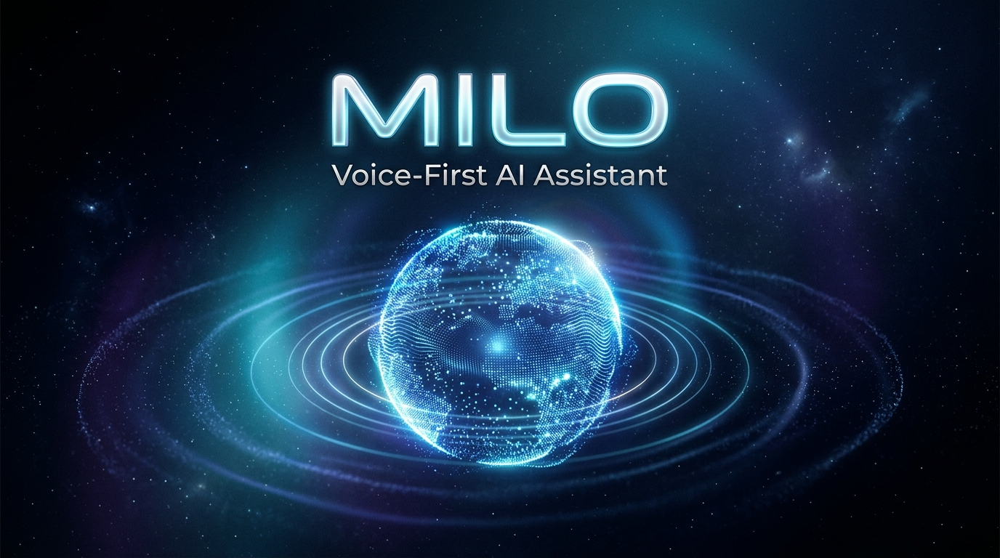
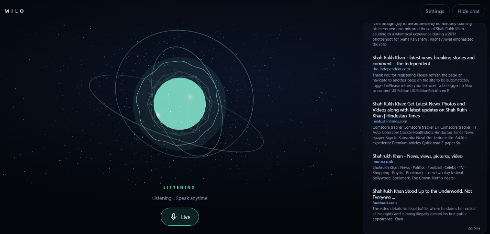
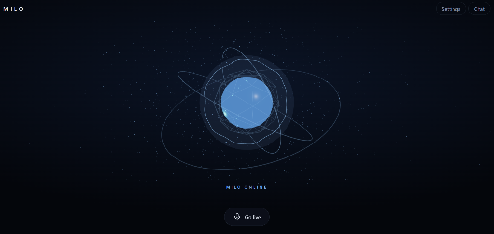
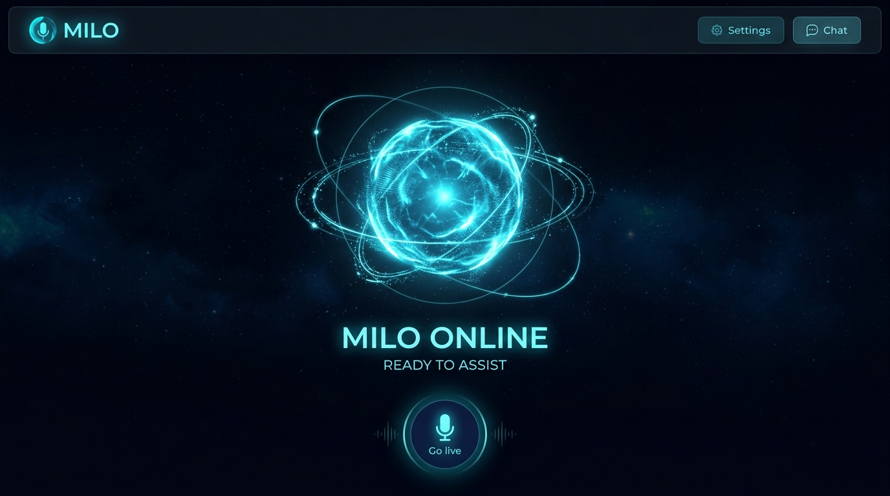
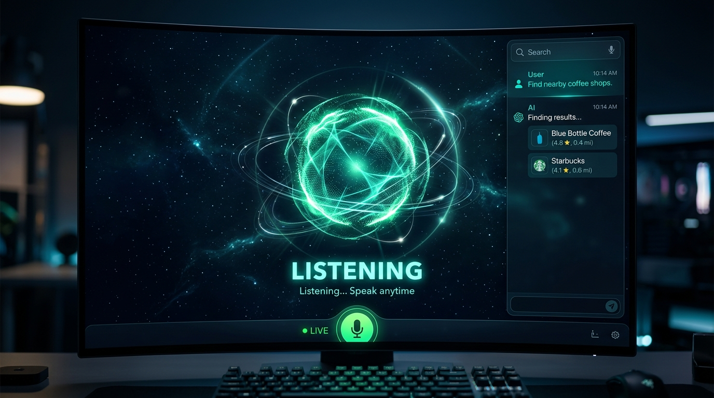
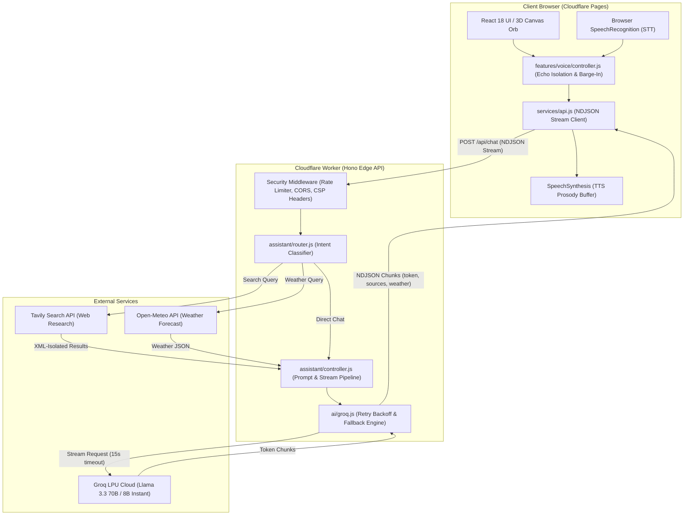

<div align="center">

  

# MILO — Voice-First AI Assistant

  <p><b>A blazing-fast, voice-native intelligent assistant powered by Groq LPU inference, Cloudflare Workers at the edge, and interactive Three.js 3D visualization.</b></p>

  <p>
    <a href="https://github.com/chetanaybuilder/Milo/actions"></a>
    <a href="LICENSE"></a>
    
    
    
    
  </p>

</div>

<hr/>

## Short Pitch

**MILO** is designed from the ground up for hands-free conversational intelligence. Instead of forcing you to wait for full AI responses or watch static loading spinners, MILO streams LLM tokens with ultra-low latency, splits streamed output into natural spoken phrases, and speaks answers with real-time prosody while an audio-reactive 3D orb visually mirrors its internal state.

With native barge-in interruptions, resilient mobile audio handling, live internet research with visual citation cards, and real-time weather forecasting, MILO offers a desktop-class voice AI experience directly in the browser.

---

## Screenshots

<div align="center">

### 1. Landing Page & Visual Presentation


<p><i>The high-aesthetic landing page featuring dynamic 3D visualizers, feature cards, interactive pipeline walkthrough, and live audio simulation.</i></p>

<br/>

### 2. Live Assistant & 3D Glass Dock


<p><i>The assistant interface featuring the 3D particle orb, HUD state indicators, floating glass composer dock, animated microphone state waves, and 3D message bubbles.</i></p>

<br/>

### 3. Voice States & Audio Reactivity

|                                                         **Idle State (Canvas HUD)**                                                          |                                                          **Listening & Reactive Audio Wave**                                                           |
| :------------------------------------------------------------------------------------------------------------------------------------------: | :----------------------------------------------------------------------------------------------------------------------------------------------------: |
|  |  |
|                                          <i>Minimalist resting orb with ambient particle rings</i>                                           |                                      <i>Active listening state reacting dynamically to user microphone input</i>                                       |

</div>

---

## Key Features

- 🎙️ **Voice-First Interaction & Live Mode**:
  - Continuous speech recognition using the Web Speech API with monotonic session sequence tracking (`_sessionId`) to eliminate stale callbacks.
  - Native iOS Safari and mobile browser accommodation with non-continuous auto-restarting recognition.
  - Sentence-level buffering parses streaming tokens on natural punctuation boundaries (`.!?\n`) to synthesize speech with natural human prosody.
- ⚡ **Ultra-Low-Latency Inference**:
  - Powered by Groq's LPU hardware executing `llama-3.3-70b-versatile`.
  - Automatic exponential backoff with jitter on HTTP 429/500–504 errors.
  - Graceful fallback to `llama-3.1-8b-instant` if rate limits or upstream capacity issues occur.
- 🛑 **Instant User Barge-In (Interruption)**:
  - Users can interrupt assistant speech at any time by pressing <kbd>Space</kbd> or <kbd>Esc</kbd>, tapping the 3D orb, or clicking the UI interrupt button.
  - Acoustic isolation logic enforces a 350ms microphone settling delay and a 1,400ms echo suppression window to prevent self-triggering feedback loops.
- 🌐 **Real-Time Web Research & Citations**:
  - Fast intent routing detects queries needing current internet knowledge and queries the Tavily Search API.
  - Generates rich 3D glass citation cards in the conversation stream featuring domain titles, Google S2 favicons, image thumbnails, and source links.
- 🌤️ **Live Weather Intelligence**:
  - Instant meteorological forecasting via Open-Meteo with geocoding, temperature, feels-like, wind speed, humidity, and precipitation.
- 🎨 **Audio-Reactive 3D Canvas Orb**:
  - Interactive particle sphere, core glow, and particle field built with `@react-three/fiber` and Three.js.
  - Reacts in real time to audio volume and operational states (`IDLE`, `LISTENING`, `THINKING`, `TOOL_USE`, `SPEAKING`, `ERROR`). Includes lightweight CSS 3D fallback for devices without WebGL.
- 🛡️ **Defense-in-Depth Security (9.2/10 Rating)**:
  - Strict token-bucket per-IP rate limiting, strict CORS allowlist, prompt-injection isolation tags (`<untrusted_search_results>`), output sanitization blocking XSS URI schemes, and strict CSP/HSTS production headers.

---

## Architecture Diagram

The system operates across a distributed edge topology, connecting a static React frontend to an edge-deployed Cloudflare Worker:



---

## Tech Stack

| Domain                   | Technology                                                   | Purpose                                                     |
| :----------------------- | :----------------------------------------------------------- | :---------------------------------------------------------- |
| **Frontend Framework**   | React 18.3 + Vite 5                                          | Reactive component model and sub-second HMR bundler         |
| **3D Graphics**          | Three.js + `@react-three/fiber`                              | Audio-reactive 3D orb and particle visualization            |
| **Styling & Aesthetics** | Vanilla CSS (CSS 3D & Glassmorphism)                         | High-performance styling without CSS runtime overhead       |
| **Speech APIs**          | Web Speech API (`SpeechRecognition`, `speechSynthesis`)      | Zero-cost browser-native voice recognition and synthesis    |
| **Backend API**          | Cloudflare Workers + Hono 4.6                                | Serverless edge router with sub-10ms cold start times       |
| **LLM Inference**        | Groq LPU (`llama-3.3-70b-versatile`, `llama-3.1-8b-instant`) | Ultra-fast token generation (~250+ tokens/sec)              |
| **Search Engine**        | Tavily Search API                                            | Real-time web knowledge with images and citation snippets   |
| **Weather Engine**       | Open-Meteo REST API                                          | Global weather data without requiring proprietary API keys  |
| **Code Quality**         | ESLint 9 + Prettier                                          | Automated syntax validation, linting, and style enforcement |
| **Testing**              | Pytest 9 (Python test suite)                                 | Automated verification of reference backend endpoints       |

---

## Project Structure

The project employs a clean, scalable, feature-based folder structure:

```text
milo/
├── backend-worker/                # Production Cloudflare Worker (Hono edge API)
│   ├── src/
│   │   ├── ai/
│   │   │   └── groq.js            # Groq streaming client, backoff & model fallbacks
│   │   ├── assistant/
│   │   │   ├── controller.js      # Streaming orchestrator & response lifecycle
│   │   │   ├── prompts.js         # Spoken-style system prompts & XML boundary defenses
│   │   │   └── router.js          # Fast regex intent classifier (Weather, Search, Chat)
│   │   ├── tools/
│   │   │   ├── weather.js         # Open-Meteo weather geolocation and forecasting
│   │   │   └── webSearch.js       # Tavily web search with domain & image extraction
│   │   ├── config.js              # Centralized backend worker configuration & CORS allowlist
│   │   └── index.js               # Hono app, token bucket rate limiter & security headers
│   ├── .dev.vars.example          # Safe development environment template
│   ├── package.json
│   └── wrangler.toml              # Cloudflare Worker deployment definition
│
├── frontend/                      # Production React + Vite Client (Cloudflare Pages)
│   ├── public/
│   │   ├── _headers               # Production security headers (CSP, HSTS, Permissions-Policy)
│   │   └── images/                # Static visual assets
│   ├── src/
│   │   ├── config/                # Centralized frontend configuration
│   │   │   ├── constants.js       # Endpoints, timeouts, voice timing, limits & notices
│   │   │   └── index.js           # Configuration barrel re-exports
│   │   ├── features/              # Domain-driven feature modules
│   │   │   ├── chat/              # Chat conversation UI (Dock, Bubbles, Sources, Weather)
│   │   │   ├── landing/           # High-aesthetic landing page (Hero, Features, Pipeline)
│   │   │   ├── settings/          # Voice personalization drawer (VoiceURI, Pitch, Rate)
│   │   │   └── voice/             # Voice controller, STT, TTS, 3D MiloCore orb & audio meter
│   │   ├── components/            # Shared / reusable design system components
│   │   │   └── common/            # Common UI indicators (ToolStatus)
│   │   ├── hooks/                 # Custom React hooks (useMilo, useReducedMotion)
│   │   ├── services/              # External communication services (api.js stream reader)
│   │   ├── styles/                # CSS design system stylesheets (styles.css, landing.css)
│   │   ├── App.jsx                # Root view router (Landing vs Assistant)
│   │   └── main.jsx               # React DOM entry point
│   ├── eslint.config.js           # ESLint 9 configuration
│   ├── vite.config.js             # Vite build & proxy config
│   └── package.json
│
├── backend/                       # Reference Python FastAPI backend & test suite
│   ├── app/                       # FastAPI application modules
│   ├── tests/                     # Pytest automated test suite
│   ├── pytest.ini                 # Pytest configuration
│   └── requirements.txt
│
├── docs/                          # Architecture & design documentation
│   ├── architecture.md            # Detailed architecture specification
│   └── media/                     # Application screenshots & brand banner
├── .gitignore                     # Git secret isolation rules
├── .prettierrc                    # Code formatting configuration
├── SECURITY.md                    # Security audit findings, threat model & disclosure policy
└── README.md                      # Primary project documentation
```

---

## Configuration & Environment Variables

All secret API keys are strictly confined to server-side environments. No API keys are ever bundled into client code.

### Backend Worker Configuration (`backend-worker/.dev.vars`)

Copy [`backend-worker/.dev.vars.example`](file:///d:/milo/backend-worker/.dev.vars.example) to `.dev.vars` for local development:

| Variable         | Required | Default / Example         | Purpose                                 | Source                                          |
| :--------------- | :------: | :------------------------ | :-------------------------------------- | :---------------------------------------------- |
| `GROQ_API_KEY`   | **Yes**  | `gsk_...`                 | API key for Groq LPU inference          | [Groq Console](https://console.groq.com/keys)   |
| `GROQ_MODEL`     |    No    | `llama-3.3-70b-versatile` | Primary LLM model identifier            | Groq Model Catalog                              |
| `TAVILY_API_KEY` | **Yes**  | `tvly-...`                | API key for real-time web research      | [Tavily Dashboard](https://app.tavily.com/home) |
| `CORS_ORIGINS`   |    No    | `http://localhost:5173`   | Comma-separated list of allowed origins | Cloudflare Pages URL                            |

### Frontend Configuration (`frontend/.env`)

Copy [`frontend/.env.example`](file:///d:/milo/frontend/.env.example) to `.env` if targeting a deployed Worker directly:

| Variable            | Required | Default             | Purpose                                                                                                                    |
| :------------------ | :------: | :------------------ | :------------------------------------------------------------------------------------------------------------------------- |
| `VITE_API_BASE_URL` |    No    | `""` (Empty string) | Points to remote Worker URL in production. When empty, Vite dev server proxies `/api` requests to `http://localhost:8787`. |

---

## Quick Start

### Prerequisites

- **Node.js**: v18.0.0 or higher
- **npm**: v9.0.0 or higher
- **API Keys**: Groq API key and Tavily API key

### 1. Start the Backend Worker (Local Edge Runtime)

```bash
cd backend-worker
npm install
cp .dev.vars.example .dev.vars
# Add your GROQ_API_KEY and TAVILY_API_KEY to .dev.vars
npm run dev
```

The Worker runs locally via Miniflare at `http://localhost:8787`.

### 2. Start the Frontend Application

In a separate terminal:

```bash
cd frontend
npm install
npm run dev
```

The application opens at `http://localhost:5173`. The Vite server automatically proxies `/api` calls to the local Worker.

---

## Usage Guide

1. **Entering the Assistant**:
   - On the landing page, click **"Experience Live AI"** or **"Launch Assistant"** to enter the core assistant interface.
2. **Hands-Free Live Voice**:
   - Click the **"Go live"** microphone button or tap the mic icon in the 3D dock.
   - Speak your question (e.g., _"What is the weather in Paris?"_ or _"What are the latest updates in quantum computing?"_).
   - MILO listens, processes intent, fetches necessary tools, and speaks a concise answer.
3. **Barge-In Interruption**:
   - While MILO is speaking, press <kbd>Space</kbd> or <kbd>Esc</kbd>, tap the glowing 3D orb, or click the **"Interrupt"** button to immediately halt speech and return to listening mode.
4. **Text Chat & Suggestion Chips**:
   - Type questions into the 3D floating dock or click one of the quick suggestion chips.
5. **Personalizing Voice & Pitch**:
   - Click **"Settings"** in the top navigation to select your operating system's installed voices, adjust speech speed (0.5x – 2.0x), and modify pitch.

---

## Security & Hardening

MILO incorporates comprehensive defensive measures audited to a **9.2 / 10** standard:

- 🔒 **Zero Client-Side Secrets**: All API tokens reside exclusively in Cloudflare Worker encrypted secrets or local `.dev.vars`.
- 🌐 **Strict CORS Allowlist**: Origin verification blocks wildcard origins and unauthorized domains.
- ⏱️ **Token-Bucket Rate Limiter**: 60 requests/minute per client IP (burst allowance of 15) with automated in-memory LRU/TTL garbage collection.
- 🛡️ **Prompt Injection Defenses**: Untrusted web search snippets are quarantined within `<untrusted_search_results>` XML tags with explicit instruction overrides disarming injected prompts.
- 🧼 **XSS Protection**: `safeUrl()` and `safeImageUrl()` enforce safe HTTP/HTTPS protocols, strictly rejecting `javascript:` and `data:` schemes.
- 📋 **Production Security Headers**: Configured in `frontend/public/_headers` (Content-Security-Policy, Strict-Transport-Security, X-Frame-Options, Permissions-Policy).
- 📜 **Full Policy**: See [SECURITY.md](SECURITY.md) for vulnerability disclosure procedures and detailed threat mitigations.

---

## Cloudflare Deployment

MILO is architected to deploy directly to Cloudflare's serverless infrastructure.

### Deploy Frontend (Cloudflare Pages)

1. Push your repository to GitHub or GitLab.
2. Log in to the [Cloudflare Dashboard](https://dash.cloudflare.com/) and navigate to **Workers & Pages** → **Create application** → **Pages**.
3. Select your repository and configure the build settings:
   - **Framework Preset**: `Vite`
   - **Root Directory**: `frontend`
   - **Build Command**: `npm run build`
   - **Output Directory**: `dist`
4. Add the environment variable:
   - `VITE_API_BASE_URL`: `https://milo-api.<your-subdomain>.workers.dev`
5. Click **Save and Deploy**.

### Deploy Backend Worker (Cloudflare Workers)

1. Authenticate Wrangler with Cloudflare:
   ```bash
   cd backend-worker
   npx wrangler login
   ```
2. Configure production secrets:
   ```bash
   npx wrangler secret put GROQ_API_KEY
   npx wrangler secret put TAVILY_API_KEY
   npx wrangler secret put CORS_ORIGINS
   # When prompted for CORS_ORIGINS, enter your Cloudflare Pages URL (e.g., https://milo.pages.dev)
   ```
3. Deploy the Worker:
   ```bash
   npm run deploy
   ```

---

## Verification & Testing

Verify that all builds, linters, and test suites pass:

```bash
# Frontend Linting
cd frontend
npm run lint

# Frontend Production Build
npm run build

# Python Reference Backend Test Suite
cd ../backend
pytest
```

---

## Roadmap

- [ ] **Multi-Language Speech**: Real-time multi-lingual speech recognition and automatic language detection.
- [ ] **Custom Wake Word Detection**: On-device lightweight wake word engine (e.g. _"Hey Milo"_).
- [ ] **Expanded Tool Ecosystem**: Native integrations for calendar scheduling, GitHub queries, and WolframAlpha calculations.
- [ ] **Low-Latency Voice Server**: Optional WebRTC audio streaming backend for sub-100ms bidirectional voice pipelines.

---

## Contributing

Contributions, bug reports, and pull requests are welcome! Please check [CONTRIBUTING.md](CONTRIBUTING.md) for coding conventions, commit guidelines, and development workflows.

---

## License

This project is licensed under the **MIT License**. See the [LICENSE](LICENSE) file for complete details.

---

<div align="center">
  <b>Built with passion by Chetanay Batra</b><br/>
  <i>Voice AI for the Modern Web</i>
</div>
